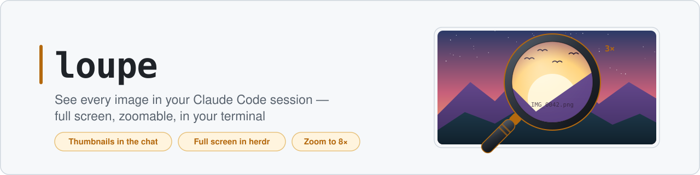
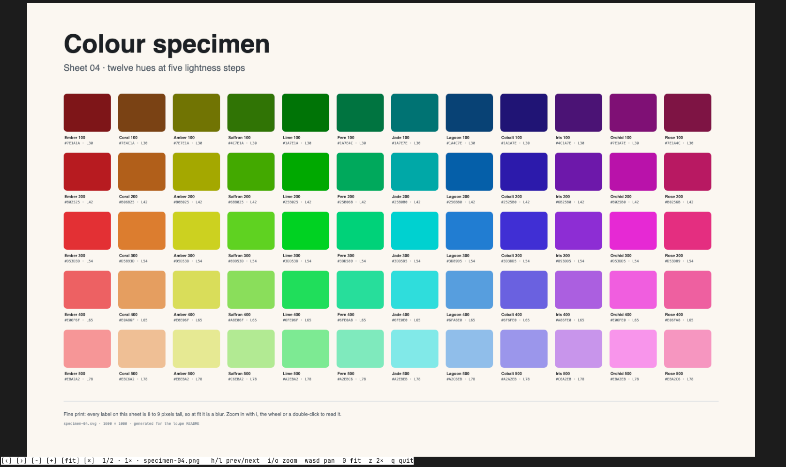
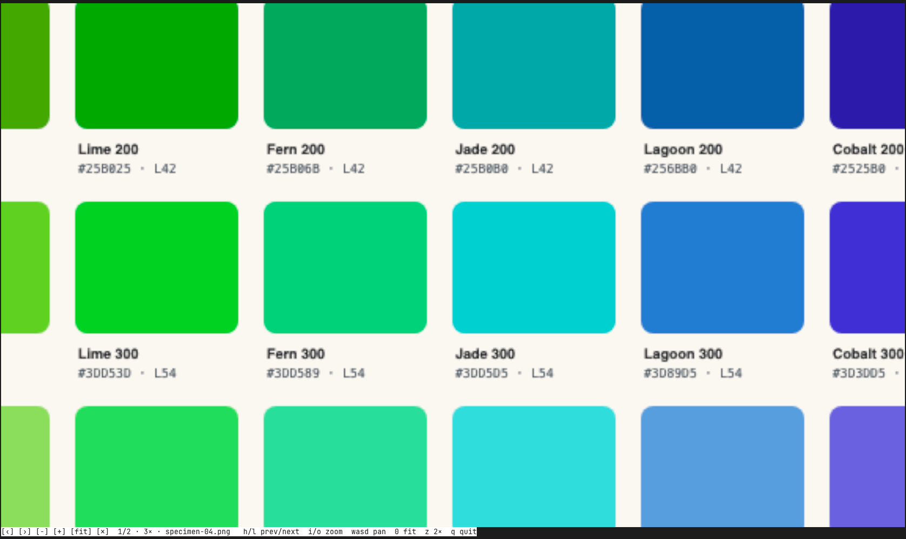
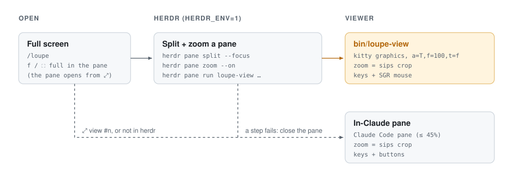

<div align="center">

<picture>
  <source media="(prefers-color-scheme: dark)" srcset="assets/banner-dark.svg">
  
</picture>

<p>
  <a href="#install"></a>
  <a href="https://herdr.dev"></a>
  
  <a href="LICENSE"></a>
</p>

**Thumbnails in the transcript, and a full-screen viewer with real-pixel zoom and pan — without leaving the terminal.**

[Features](#features) · [Install](#install) · [Keys & mouse](#keys--mouse) · [How it works](#how-it-works) · [Development](#development)

</div>

<br>

Screenshots, mockups and charts pass through a Claude Code session all the time, but the transcript only shows `[Image #1]`. loupe draws them where they appear, and opens any of them large enough to read the small print.



<p align="center">
  
  <br><sub>Fit, then <code>i</code> <code>i</code>: 3×, drawn from a <code>sips</code> crop of the original, not an upscaled thumbnail.</sub>
</p>

## Features

| | Feature | What it does |
| :-: | --- | --- |
| 🖼️ | **Thumbnails** | Images Claude reads with `Read`, puts in a reply as ``, or gets back from MCP tools show up as pictures under the row that produced them. |
| ⤢ | **Full-screen viewer** | Inside [herdr](https://herdr.dev), a herdr pane zoomed over the whole window. Elsewhere, a Claude Code pane. |
| 🔍 | **Real-pixel zoom** | 1×, 2×, 3×, 4×, 6×, 8×. Each level draws a crop of the original at full size. |
| 🖱️ | **Mouse** | Wheel zooms about the pointer, drag pans, double-click toggles 2×, status bar buttons (full-screen viewer). |
| ↔️ | **Whole session** | Step through every image of the session with `h` / `l`. |
| 🧹 | **Self-cleaning cache** | Converted files and crops live in `$TMPDIR/claude-loupe`; files older than a day are pruned at session start. |

## Quick start

1. [Install](#install) and start a new Claude Code session.
2. Ask Claude to look at a screenshot: a thumbnail appears.
3. Press `⤢ view #n` under it (or run `/loupe`), then zoom with `i` or the wheel. `q` closes.

## Requirements

- **Claude Code** with mods (plugins with a hooks module) enabled.
- **A terminal that draws kitty graphics**, such as [herdr](https://herdr.dev) or kitty.
- **macOS**: conversion and cropping use the built-in `sips`.
- `CLAUDE_CODE_FORCE_TERMINAL_IMAGES=1`, so Claude Code draws images even when it cannot detect support.
- Optional: **herdr**, for the full-window viewer. Nothing else to install: `bin/loupe-view` is a bash script using `sips`, `base64` and `stty`.

## Install

```sh
git clone https://github.com/ggwhite/loupe.git ~/src/loupe
```

In `~/.claude/settings.json` (`CLAUDE_CODE_PLUGIN_DIRS` is colon-separated, so append to what is there):

```json
{
  "env": {
    "CLAUDE_CODE_PLUGIN_DIRS": "/path/to/other-mod:/Users/you/src/loupe",
    "CLAUDE_CODE_FORCE_TERMINAL_IMAGES": "1"
  }
}
```

Start a new session. `/loupe` opens the newest image; `/loupe clear` forgets this session's images and deletes their cache files.

## Keys & mouse

The full-screen viewer (`bin/loupe-view`):

| Key | Mouse | Action |
| --- | --- | --- |
| `h` / `l` | Click the left / right tenth of the screen, `[‹]` / `[›]` | Previous / next image (the zoom resets) |
| `i` / `o` | Wheel up / down (about the pointer), `[+]` / `[−]` | Zoom in / out one level |
| `z` | Double-click (about the clicked point) | Toggle 2× |
| `0` | `[fit]` | Fit the whole image |
| `w` `a` `s` `d` | Left drag | Pan (keys move half of what is visible) |
| `q` or `Esc` | `[✕]` | Quit and close the pane |

The right and middle buttons do nothing. herdr passes mouse events to the pane with its default `mouse_capture = true`; the right button stays herdr's pane menu unless `right_click_passthrough_modifier` is set. On a narrow window the key hints shrink to `h/l i/o wasd 0 z q`, or are left out.

`bin/loupe-view 1 a.png b.png` also runs on its own in any terminal that reads kitty images from a file path.

## In-Claude pane fallback

Outside herdr, or if any herdr step fails, the viewer opens in a Claude Code pane and takes the focus. Same keys, with these differences:

| Key | Action |
| --- | --- |
| `x` or `Esc` | Close the viewer |
| `f` | `⛶ full`: try the full-screen viewer again at this image (inside herdr only) |
| `+` / `−` buttons | Zoom one level, like `i` / `o` |

The title line shows where you are, e.g. `2 of 5 · 2× · settings-page.png`. There is no mouse zoom or drag here.

## How it works

<picture>
  <source media="(prefers-color-scheme: dark)" srcset="assets/architecture-dark.svg">
  
</picture>

- **herdr.** With `HERDR_ENV=1` and `HERDR_PANE_ID` set at session start, loupe runs `herdr pane split --pane $HERDR_PANE_ID --direction right --focus --cwd $HOME`, then `herdr pane zoom --pane <new> --on`, then `herdr pane run <new> "'<mod>/bin/loupe-view' <n> '<png>' ..."` with every image of the session. If the zoom or run fails, it closes the pane it split and falls back.
- **loupe-view.** Alternate screen, hidden cursor, kitty graphics by file path (`a=T,f=100,t=f`), since herdr does not draw directly transmitted images. It asks for the cell size (`CSI 16 t`, 1:2 if no answer), redraws on resize, and restores the terminal on every way out, mouse reporting (`?1000`, `?1002`, `?1006`) included.
- **Zoom by cropping.** From the image size and the cell box, loupe works out the visible pixels and cuts them out with `sips -c <h> <w> --cropOffset <y> <x>`. Each crop is made once and reused.
- **PNG everywhere.** JPEG, GIF, WebP, HEIC, ... are converted once with `sips -s format png` and reused while the source is unchanged. Images subagents read are converted only when the viewer shows them.
- **Cache.** `$TMPDIR/claude-loupe` (or `/tmp/claude-loupe`); files older than a day are pruned at session start, and a running session's files are kept fresh every hour.

## Limits

- **Pane width.** A docked Claude Code pane is capped at 45% of the terminal's columns. The herdr viewer avoids the cap; elsewhere it applies.
- **Full-screen viewer** needs herdr and a terminal that reads kitty images from a file path (`t=f`), so not a remote session whose files are elsewhere. It shows the images loupe had when it opened.
- **No `=` / `-` keys** in the Claude Code pane: hotkeys are single letters or digits. Under 40 columns the buttons are left out and `i: in` / `o: out` join the key line.
- **Very large files** beyond Claude Code's file read cap show at fit only.
- **Zoom depth** stops at one image pixel per terminal cell, so small images may not zoom at all.

## Development

```sh
claude plugin test ~/src/loupe        # run the tests
claude plugin validate ~/src/loupe    # check the manifest and hooks module
npx -y -p typescript tsc -p .         # type-check (from the repository root)
bin/loupe-view --self-test            # check loupe-view's fit and crop math against hooks/layout.ts
```

The engine writes its type definitions into `.claude-plugin/types/` the first time it loads the mod. The banner and diagram are hand-written SVGs in `assets/`.

## License

[MIT](LICENSE) © 2026 ggwhite
